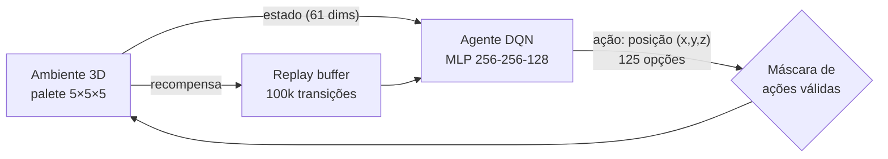

<div align="center">

# DeepReinforcedLearn: agente de paletização 3D (Projeto IRIS)

**Aprendizado por reforço para decidir onde e em que orientação empilhar cada caixa em um palete, respeitando estabilidade física**

Módulo de IA do **IRIS (Integrated Robotic Intelligence Systems)**, 1º lugar no FIAP NEXT 2025, Challenge proposto pela **Unilever**


</div>

---

## O problema

No IRIS, esteiras IoT trazem caixas de tamanhos variados, e um braço robótico precisa montar o palete. A decisão de **onde colocar cada caixa** define três coisas:

- **Ocupação:** quanto do volume do palete é aproveitado
- **Estabilidade:** se a carga vai tombar no transporte
- **Tempo de ciclo:** quantas tentativas o robô perde

É uma variante online do *3D Bin Packing Problem* (NP-difícil): as caixas chegam em sequência e o agente só conhece as próximas *k*.

## A abordagem



**Estado observado (61 valores, com lookahead de 10):**

- mapa de alturas do palete (5 × 5 = 25)
- dimensões da caixa atual (3) e das próximas 10 (30)
- ocupação total, caixas já colocadas e passos restantes (3)

**Ação:** uma das 125 posições (x, y, z). O ambiente testa as **6 orientações** da caixa e usa a primeira que cabe.

**Regra de estabilidade física:** uma caixa só pode ser apoiada se **pelo menos 70% da sua base** estiver sobre outras caixas. É isso que faz o agente decidir pelo equilíbrio real, e não só pela geometria.

**Recompensa:** +50 por caixa colocada, −5 por tentativa inválida, +500 se o palete for completado.

### Componentes

| Arquivo | Conteúdo |
|---|---|
| `environment.py` | `PalletizingEnvironment` (física, estado, recompensa, render 3D em matplotlib) e `PalletizingEnv`, wrapper Gymnasium para os fluxos PPO |
| `agent.py` | `ImprovedDQNAgent`: DQN com rede-alvo, Huber loss, gradient clipping, ε-greedy com **action masking** e **beam search** opcional |
| `main.py` | Painel interativo: treinar, avaliar e plotar curvas |
| `train_ppo.py` · `run_project.py` · `evaluate_ppo.py` | Fluxo alternativo com PPO (Stable-Baselines3), 4 ambientes paralelos |
| `evaluate.py` | Simulação visual 3D com uma lista de caixas definida pelo usuário |
| `agent_cnn_hybrid.py` | Rascunho de rede híbrida CNN + MLP (mapa do palete como imagem) |

---

## Como rodar

```bash
cd DRL_Next2k25
pip install -r requirements.txt

python main.py                                   # menu: treinar / avaliar
python evaluate.py --model best_palletizing_agent.pth --items 2x2x1 1x3x2 3x3x1 2x1x1
python evaluate_ppo.py --model ppo_palletizer_final --random_test 50
```

Modelos já treinados no repositório:

| Arquivo | Algoritmo |
|---|---|
| `best_palletizing_agent.pth` | DQN (melhor média móvel de 100 episódios) |
| `palletizing_agent.pth` | DQN (final do treino) |
| `ppo_palletizer_final.zip` | PPO, ~508 mil timesteps |

---

## Como o agente otimiza o palete

A cada caixa que chega, o agente avalia todas as posições possíveis e escolhe a que **maximiza o retorno esperado** do palete inteiro, não só da jogada atual:

- **Visão de futuro:** com lookahead de 10 caixas, ele reserva espaço para as peças grandes que ainda vão chegar
- **Estabilidade garantida:** a máscara de ações descarta qualquer posição com menos de 70% de apoio, então o robô nunca recebe uma ordem que deixaria a carga instável
- **Orientação automática:** para cada posição, o ambiente testa as 6 rotações da caixa
- **Planejamento com beam search:** no modo de avaliação, o agente simula os k melhores movimentos um passo à frente antes de decidir
- **Simulação 3D:** `evaluate.py` mostra o palete sendo montado caixa a caixa, com a próxima caixa em destaque

## Roadmap

- [ ] Recompensa proporcional ao **volume** da caixa e penalidade por **vazios** e altura máxima
- [ ] **Double DQN** de verdade (seleção pela rede online, avaliação pela alvo) e soft update (τ)
- [ ] `MaskablePPO` (sb3-contrib). O wrapper já expõe `action_masks()`
- [ ] Demonstrações iniciais (*imitation warm-start*) para acelerar o treino
- [ ] Rede híbrida CNN + MLP (`agent_cnn_hybrid.py`) para ler o mapa de alturas como imagem
- [ ] Integração com o WMS do IRIS e envio das posições ao braço robótico

---

## Correções desta versão

- `agent.load_model` agora usa `map_location`: modelos treinados em GPU carregam em máquinas só com CPU.
- Criado o wrapper Gymnasium `PalletizingEnv`. Os scripts PPO importavam essa classe, mas ela não existia, e agora funcionam. O ambiente passa no `check_env` do SB3.
- Corrigido o import `stable_baseline_3` → `stable_baselines3` em `train_ppo.py`.
- `requirements.txt` revisado (removidos pacotes inexistentes ou não usados).
- Adicionado `.gitignore`.

## Contexto: Projeto IRIS

O IRIS é um ecossistema de Logística 5.0: esteiras IoT, braços robóticos, AGVs autônomos, redundância mecânica com encaixe rabo de andorinha contra queda de paletes e um WMS próprio em Python e React. Este módulo é o "cérebro" que decide a montagem do palete.

**Equipe:** Rômulo Estevam Xavier, Fernando Bertolucci, Gustavo Paraszczuk de Azevedo Marques, Leonardo Ken Stefano e Jennifer de Souza
**Mentores:** Hete Caetano, Valter Santiago Rosa Filho e Renê Oliveira · **Instituição:** FIAP · **Desafio:** Unilever

Desenvolvido por [Rômulo Estevam Xavier](https://www.linkedin.com/in/romulo-estevam-xavier/) · MYND (Make Your New Dreams)
